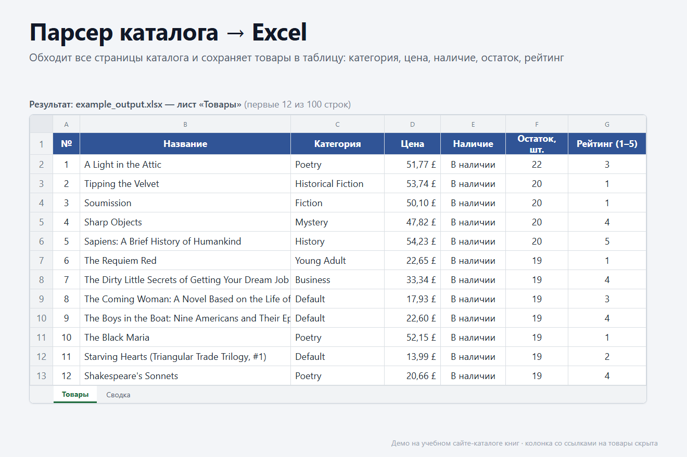
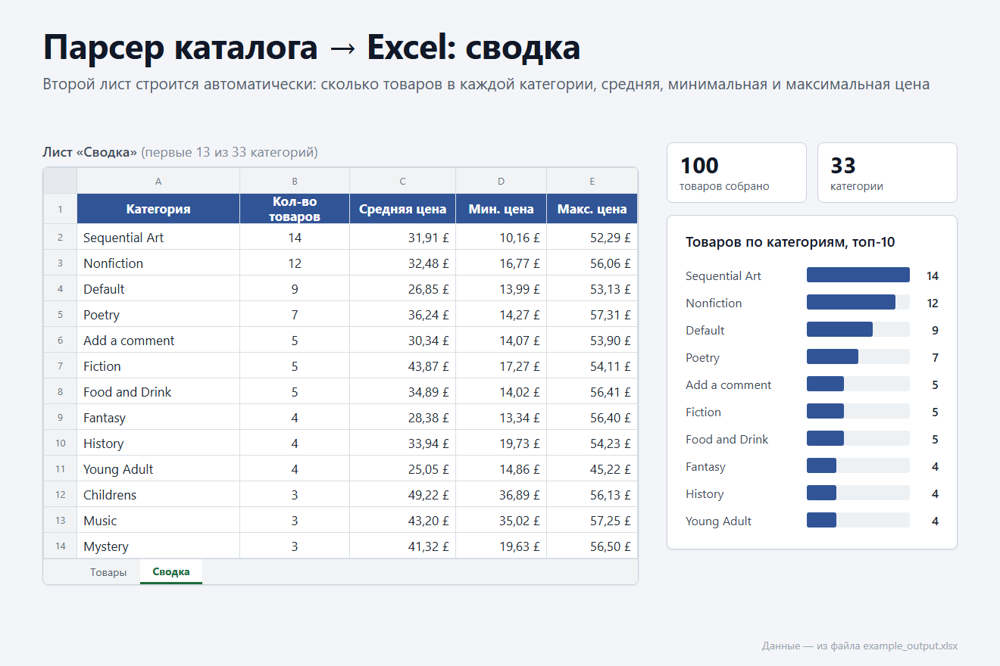

# Парсер каталога сайта → Excel

## Как выглядит результат





Программа сама проходит по всем страницам каталога интернет-магазина, собирает
данные о каждом товаре и складывает их в аккуратную таблицу Excel. Не нужно
ничего копировать руками: запустили — через несколько минут получили готовый файл,
который можно сортировать, фильтровать и отправлять дальше.

Демо сделано на сайте [books.toscrape.com](https://books.toscrape.com) —
это учебный магазин книг, специально созданный для отработки парсинга.
Тот же подход подходит для каталогов реальных магазинов, маркетплейсов,
досок объявлений и справочников (с учётом правил конкретного сайта).

## Что собирается

По каждому товару:

| Поле | Пример |
|---|---|
| Название | A Light in the Attic |
| Категория | Poetry |
| Цена (числом, можно считать формулами) | 51,77 £ |
| Наличие | В наличии |
| Остаток, шт. | 22 |
| Рейтинг (звёзды, 1–5) | 3 |
| Ссылка на товар (кликабельная) | https://books.toscrape.com/catalogue/a-light-in-the-attic_1000/index.html |

## Пример результата

В папке лежит [`example_output.xlsx`](example_output.xlsx) — первые 5 страниц
каталога, 100 товаров. В файле два листа:

**«Товары»** — вся собранная информация:
- жирная шапка, закреплённая при прокрутке;
- автофильтр на всех колонках (сортировка и отбор в один клик);
- цена хранится как число в денежном формате, а не как текст;
- ссылки кликабельные — открывают страницу товара.

**«Сводка»** — итоги по категориям: количество товаров, средняя, минимальная
и максимальная цена, строка «ИТОГО», источник и дата выгрузки.

Фрагмент сводки из примера:

| Категория | Кол-во товаров | Средняя цена |
|---|---|---|
| Sequential Art | 14 | 31,91 £ |
| Nonfiction | 12 | 32,48 £ |
| Default | 9 | 26,85 £ |
| Poetry | 7 | 36,24 £ |
| … | … | … |
| **ИТОГО** | **100** | **34,56 £** |

> «Default» и «Add a comment» — это не ошибка парсера, такие категории
> действительно есть на учебном сайте.

## Как это работает

- Вежливо к сайту: пауза ~0,5 с между запросами, чтобы не перегружать сервер.
- Устойчиво к сбоям: при ошибке сети запрос повторяется (до 3 попыток
  с нарастающей паузой); если один товар так и не загрузился — он пропускается,
  остальные собираются.
- Понятный прогресс в консоли: номер страницы, каждый товар, сколько собрано
  и сколько прошло времени.
- Если остановить программу (Ctrl+C), уже собранные данные всё равно
  сохранятся в Excel.

## Как запустить на Windows

1. Установите Python 3.10 или новее с [python.org](https://www.python.org/downloads/).
   При установке отметьте галочку **«Add python.exe to PATH»**.
2. Откройте папку проекта в Проводнике, кликните в адресную строку,
   наберите `powershell` и нажмите Enter — откроется консоль в этой папке.
3. Создайте виртуальное окружение (один раз):
   ```powershell
   python -m venv .venv
   ```
4. Установите зависимости (один раз):
   ```powershell
   .\.venv\Scripts\python.exe -m pip install -r requirements.txt
   ```
5. Запустите парсер:
   ```powershell
   .\.venv\Scripts\python.exe parser.py
   ```
   Готовый файл `books_ДАТА_ВРЕМЯ.xlsx` появится в этой же папке.

Полный каталог — 50 страниц, 1000 товаров — собирается примерно за 10 минут
(программа заходит на страницу каждого товара, чтобы взять категорию и остаток).
5 страниц — меньше минуты.

## Параметры

| Параметр | Что делает | Пример |
|---|---|---|
| `--pages N` | обработать только первые N страниц каталога | `--pages 5` |
| `--category ИМЯ` | собрать только одну категорию (регистр не важен) | `--category "Science Fiction"` |
| `--out ФАЙЛ` | куда сохранить Excel | `--out C:\Отчёты\книги.xlsx` |
| `--delay СЕК` | пауза между запросами, по умолчанию 0.5 | `--delay 1` |
| `-h` | показать справку | |

Примеры:

```powershell
# первые 5 страниц в файл example_output.xlsx
.\.venv\Scripts\python.exe parser.py --pages 5 --out example_output.xlsx

# только категория «Mystery»
.\.venv\Scripts\python.exe parser.py --category Mystery --out mystery.xlsx

# первые 2 страницы категории «Fantasy»
.\.venv\Scripts\python.exe parser.py --category Fantasy --pages 2
```

Если указать несуществующую категорию, программа выведет список всех доступных.

## Файлы проекта

- `parser.py` — сам парсер;
- `requirements.txt` — список нужных библиотек;
- `example_output.xlsx` — пример результата;
- `.gitignore` — что не попадает в репозиторий (окружение, кэш, выгрузки).

Технологии: Python, requests, BeautifulSoup, openpyxl.
